  

 

  
  
  

 

  
  <picture>
    <source media="(prefers-color-scheme: dark)" srcset="assets/github-snake-dark.svg">
    <source media="(prefers-color-scheme: light)" srcset="assets/github-snake.svg">
    
  </picture>

 

  

 

### `> REPOSITORIES // CORE PROCESSES`

| Project | Description | Stack |
| :--- | :--- | :--- |
| 📈 **[QUANT-JOURNEY](https://github.com/STUCKINLOOP8/QUANT-JOURNEY)** | Foundations for quantitative research, algorithmic trading, DSA, and probability models. | `Python` `Algorithms` `Quant` |
| ⚡ **[chance-O-meter](https://github.com/STUCKINLOOP8/chance-O-meter)** | Predictive ride-booking engine computing live success probabilities and transit routing. | `JavaScript` `Transit Engine` |
| 🧮 **[worst-calculator](https://github.com/STUCKINLOOP8/worst-calculator)** | Algorithmic experiment exploring UX anomalies and unconventional compute mechanics. | `Software` `Creative UI` |

 

  <code>[PROCESS: ACTIVE] &bull; while (alive) { code(); } &bull; STUCK IN LOOP 8</code>

